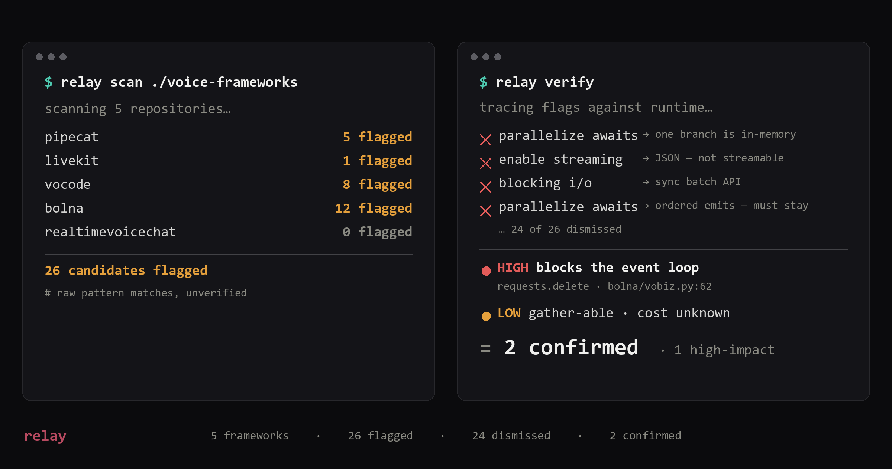

<div align="center">


### Find the latency in your AI agent, before your users do.

Relay is an open-source **MCP server + CLI** that audits AI agent and voice-agent
codebases for latency bottlenecks. It reads your real source with an AST engine, ranks
issues by impact, runs a verification pass to drop false positives, and can apply fixes
directly from Claude Code.

**No account. No API key. No backend.** It runs entirely on your machine.

[](https://github.com/arclat-ai/relay-mcp/actions/workflows/ci.yml)
[](https://www.python.org/downloads/)
[](LICENSE)

<!-- After the first PyPI release, swap the two badges above for these live ones:
[](https://pypi.org/project/relay-arclat/)
[](https://pypi.org/project/relay-arclat/)
-->


[Quickstart](#quickstart) · [MCP tools](#mcp-tools) · [CLI](#cli) · [What it detects](#what-it-detects) · [Contributing](CONTRIBUTING.md)

</div>

<br>



---

## Why Relay

Agent latency is rarely one slow model call. It is a streaming response that was never
streamed, three awaits that should have been one `asyncio.gather`, an HTTP client
rebuilt on every request, a `requests.post` sitting inside an `async def`. These are
structural, they are invisible in a profiler flame graph averaged over a request, and
they are obvious in the AST.

Relay finds them, then argues with itself about each one so you don't get a wall of
false positives.

---

## Quickstart

### In Claude Code (MCP)

```bash
claude mcp add relay -- uvx --from relay-arclat relay-mcp
```

Or add it to your MCP config (`~/.claude/claude_code_config.json`) by hand:

```json
{
  "mcpServers": {
    "relay": {
      "command": "uvx",
      "args": ["--from", "relay-arclat", "relay-mcp"]
    }
  }
}
```

Then, in Claude Code, just say:

> Audit this codebase for latency issues

That's it - there is no key to configure.

### As a CLI

```bash
pip install relay-arclat  # or: uv tool install relay-arclat

relay scan   .            # structural pass - candidate latency patterns
relay verify .            # semantic pass  - only the confirmed gaps
relay report .            # write relay-report.json
```

Requires Python 3.11+.

---

## Features

- **AST-based detection.** Parses Python with the real grammar, not regexes, so it
  understands `async`/`await`, call targets, keyword arguments, and `**kwargs`
  forwarding.
- **Six latency detectors.** Streaming gaps, sequential tool calls, cache misses,
  blocking I/O in async code, per-request client construction, and prefetch
  opportunities - see [What it detects](#what-it-detects).
- **Verification pass.** Every candidate is re-read in context and either confirmed as a
  real gap or dismissed as a false positive, each with a one-line reason.
- **Impact ranking.** Findings are scored and sorted so the highest-impact fixes surface
  first.
- **Apply fixes from Claude Code.** `apply_fix` rewrites the flagged site (dry-run by
  default) so you review before anything is written.
- **MCP and CLI share one engine.** Agent output and terminal output never diverge.
- **CI gate.** `relay verify --fail-on high` exits non-zero when a confirmed high-impact
  gap remains, so it can fail a pipeline.
- **Dashboard reports.** Each audit writes a `relay-report.json` you can drop into the
  [Relay dashboard](https://relay.arclat.com/dashboard) for a visual view.
- **Essentially no dependencies.** Just the `mcp` package - no network calls, no
  telemetry, nothing leaves your machine.
- **Persistent state.** The last audit is cached at `~/.relay/last-audit.json`, so
  `get_findings`, `verify_audit`, and `apply_fix` keep working across MCP restarts.

---

## MCP tools

| Tool | Description |
|------|-------------|
| `audit_codebase(directory, write_report=true)` | Reads Python files in a directory, returns ranked findings (each with a verification verdict) and writes `relay-report.json`. |
| `get_findings(severity?, finding_type?, status?)` | Filters findings from the last audit. |
| `verify_audit()` | Shows which findings the semantic pass confirmed vs dismissed, with reasons. |
| `apply_fix(finding_rank, file_path?, dry_run=true)` | Applies a fix. Dry run by default; file path defaults to the finding's file. |

The last audit is cached at `~/.relay/last-audit.json`, so the read-only tools keep
working after an MCP server restart.

---

## CLI

```bash
relay scan   <dir>          # structural pass - flag candidate latency patterns
relay verify <dir>          # semantic pass  - keep only confirmed gaps
relay report <dir> [-o f]   # write relay-report.json for the dashboard
relay mcp                   # run the MCP server (same as relay-mcp)
```

| Flag | Applies to | Meaning |
|------|-----------|---------|
| `--json` | `scan`, `verify` | Print the full report as JSON (for CI, `jq`). |
| `--fail-on {none,high,any}` | `verify` | Exit non-zero when confirmed gaps remain. Default `none`. |
| `-o, --output` | `report` | Output path. Default `<dir>/relay-report.json`. |

### Use in CI

```yaml
- run: pip install relay-arclat
- run: relay verify . --fail-on high
```

`--fail-on high` fails the job only when a **confirmed** high-impact gap remains, so a
noisy structural match will not break your build.

---

## What it detects

| Detector | What it flags |
|----------|---------------|
| **SyncOutput** | LLM calls missing streaming (`stream=True`), including calls that forward `**kwargs`. |
| **SequentialTools** | Consecutive data-independent awaits that should run under `asyncio.gather()`. |
| **CacheMiss** | The same fully-static LLM call repeated at multiple call sites with no caching. |
| **BlockingIO** | Sync `requests` / DB calls, plus `time.sleep` and blocking `subprocess` calls inside async functions. |
| **ColdStart** | API clients (`OpenAI`, `httpx.Client`, `aiohttp.ClientSession`, …) built per request instead of at startup. |
| **Prefetch** | Predictable tool-call pairs that could be started speculatively. |

### The verification pass

Every finding is re-read in context and either **confirmed** as a real latency gap or
**dismissed** as a false positive, with a one-line reason either way - for example
*"one branch (lookup) is in-memory - nothing to parallelize"* or
*"structured/JSON output - not streamable"*. The summary counts
(`flagged`, `confirmed`, `dismissed`, `confirmed_high_impact`) drive both the CLI output
and the `--fail-on` CI gate.

This is the difference between a linter you mute after a week and one you keep in CI.

---

## The dashboard

Relay itself is fully local. If you want a visual view of a report, the
[Relay dashboard](https://relay.arclat.com/dashboard) lets you drag in any
`relay-report.json` and browse findings, severity breakdown, and time-lost aggregates.
The report never leaves your browser - it is parsed client-side.

---

## Configuration

None. Relay needs no environment variables, no config file, and no API key. It reads
your source, writes a report, and does nothing else.

---

## Repository structure

```
relay-mcp/
├── mcp_server/          # MCP server + CLI (ships as relay-arclat on PyPI)
│   ├── server.py        # entry point, exposes the MCP tools
│   ├── cli.py           # `relay` command (scan / verify / report / mcp)
│   └── engine/          # audit engine (detectors, scorer, verify, code_parser)
├── tests/               # end-to-end engine tests
├── assets/              # logo and screenshots
├── run.sh / run.ps1     # dev runners (install / register / test / serve)
└── pyproject.toml       # package config for uvx / pip install
```

---

## Development

```bash
pip install -e ".[dev]"   # install relay + relay-mcp in editable mode
pytest                    # run the test suite
ruff check .              # lint
relay scan .              # dogfood the engine on itself
```

See [RUNNING.md](RUNNING.md) for the full dev workflow and
[CONTRIBUTING.md](CONTRIBUTING.md) for how to add a detector or open a PR.

---

## Project

- **Contributing** - [CONTRIBUTING.md](CONTRIBUTING.md)
- **Code of conduct** - [CODE_OF_CONDUCT.md](CODE_OF_CONDUCT.md)
- **Security policy** - [SECURITY.md](SECURITY.md)
- **Changelog** - [CHANGELOG.md](CHANGELOG.md)

Relay is a product of the **Arclat** studio. Learn more at
[relay.arclat.com](https://relay.arclat.com).

## License

[MIT](LICENSE)
